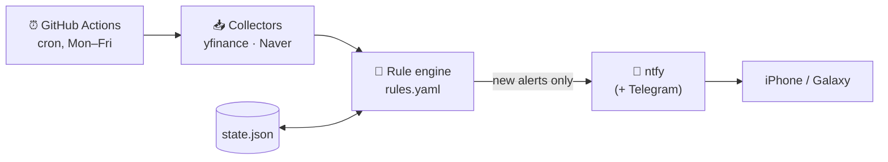

<div align="center">

# 📈 StockAltert

**Rule-based stock & macro alerts, pushed straight to your phone.**
<br>
Free, serverless — runs on GitHub Actions and notifies iPhone / Galaxy via [ntfy](https://ntfy.sh).


[English](#-english) · [한국어](#-한국어)

</div>

---

## 🇺🇸 English

### What it does

You write your price targets and macro triggers in one file, **`rules.yaml`**.
Four times every weekday, a GitHub Actions job fetches market data, checks every rule, and sends a push notification **only for conditions that just turned on** — no spam, no repeats.

- 🎯 **Price targets**: buy below X, sell above Y, buy inside a range
- 🌍 **Macro signals**: US 10Y yield, VIX, S&P 500, Nasdaq 100, SOX, USD/KRW, BTC
- 🇰🇷 **Korean flows**: KOSPI / per-stock foreign net buying N days in a row (Naver Finance)
- 📊 **Valuation & trend**: P/B or P/E thresholds, price N% above the 200-day MA, "above MA50 for N days"
- 🔁 **No duplicate alerts**: a rule re-arms only after price moves 5% away from the level
- 💸 **Zero cost**: no server, no database — state is a JSON file the bot commits back

### How it works



| Run (KST) | Market | Why |
|---|---|---|
| 09:10 | 🇰🇷 KR | right after Korean open |
| 15:00 | 🇰🇷 KR | 30 min before Korean close |
| 23:40 | 🇺🇸 US | right after US open (09:40 ET; 10:40 ET during US daylight saving) |
| 05:50 | 🇺🇸 US | 10 min before US close (15:50 ET; just after close during US daylight saving) |

> Macro tickers (`^TNX`, `^VIX`, `KRW=X`, `BTC-USD`) are checked on every run.

### What a notification looks like

```text
알리미 KR 2026-11-09
[BUY] SK하이닉스
948,000.00 ≤ 950,000
→ 매수 2주 (PBR 1.1)

[WATCH] 애플
288.40 ≤ 290

⚠️ 수집 실패:
- naver 000660 trend failed: Timeout
```

Buy/sell alerts arrive with **high** priority (sound + vibration). Watch-only alerts and errors use default priority.

### 📲 Setup (~10 min)

#### 1. Install ntfy on your phone

| | iPhone | Galaxy / Android |
|---|---|---|
| App | [App Store](https://apps.apple.com/app/ntfy/id1625396347) | [Google Play](https://play.google.com/store/apps/details?id=io.heckel.ntfy) |
| Subscribe | **+** → enter your topic → server `ntfy.sh` | **+** → enter your topic → turn on **Instant delivery** |
| Tip | Allow notifications when asked | Exclude ntfy from battery optimization so alerts aren't delayed |

**Pick a long random topic name**, e.g. `ss-alert-7f3k9x2m`. Anyone who knows the topic can read it — treat it like a password. Subscribe to the same topic on every phone you want alerted.

Test it right away from any terminal:

```bash
curl -d "hello from StockAltert 👋" ntfy.sh/your-topic-name
```

#### 2. Configure GitHub

1. Fork or push this repo.
2. **Settings → Secrets and variables → Actions → New repository secret**

   | Secret | Required | Value |
   |---|---|---|
   | `NTFY_TOPIC` | ✅ | your topic name |
   | `NTFY_TOKEN` | – | access token, only for a protected topic |
   | `TELEGRAM_BOT_TOKEN` | – | from [@BotFather](https://t.me/BotFather), for optional Telegram |
   | `TELEGRAM_CHAT_ID` | – | your chat id |

   The topic lives in Secrets, so it stays hidden even in a public repo.
3. **Settings → Actions → General → Workflow permissions → Read and write** (lets the bot commit `state.json`).
4. **Actions → stock-alert → Run workflow** once, and check that your phone buzzes.

#### 3. Edit your rules

Change numbers in `rules.yaml` and push. You don't need to touch any code.

### 📝 Rule syntax

```yaml
- id: hynix_buy                  # unique id (used as the state key)
  ticker: "000660.KS"            # Yahoo Finance ticker
  krx: "000660"                  # (optional) KRX code, for Naver flow data
  name: "SK하이닉스"
  type: price_below              # see table below
  level: 950000                  # price_between uses low / high instead
  note: "매수 2주"                # shown under the alert
  watch: true                    # (optional) watch-only, lower priority
  expires: "2026-11-18"          # (optional) ignored after this date
  requires: ess_order_confirmed  # (optional) only when this manual flag is true
  and: {above_ma50_days: 3}      # (optional, price_above) also above MA50 for N days
```

| `type` | Fires when | Extra fields |
|---|---|---|
| `price_below` | price ≤ `level` | |
| `price_above` | price ≥ `level` | `and.above_ma50_days` |
| `price_between` | `low` ≤ price ≤ `high` | `low`, `high` |
| `metric_below` | a Yahoo metric ≤ `level` | `metric`: `priceToBook`, `trailingPE`, `forwardPE` |
| `ma200_above_pct` | any of `tickers` is ≥ `pct`% above its 200-day MA | `tickers`, `pct` |
| `krx_foreign_net_buy_days` | KOSPI foreigners net-bought `days` days in a row | `days` |
| `stock_foreign_net_buy_days` | foreigners net-bought this stock `days` days in a row | `krx`, `days` |

**Manual flags.** `rules.yaml → manual:` holds switches you flip yourself when news comes in, such as an earnings result. A rule with `requires: <flag>` stays silent until that flag is `true`.

### ⚙️ Behavior

- **One alert per crossing.** After firing, a rule re-arms only once price moves `rearm_pct` (default 5%) back past the level.
- **Failures still report.** Data errors are listed at the bottom of the alert with ⚠️. If Naver is down, price rules keep working through yfinance.
- **Delayed data.** yfinance is about 15–20 minutes behind, so this is for swing and position trading, not day trading.
- **Weekends are skipped.**

### 🛠 Local development

```bash
python -m venv .venv && source .venv/bin/activate   # Windows: .venv\Scripts\activate
pip install -r requirements.txt pytest

python -m pytest tests/                        # engine unit tests
python -m src.main --market US --dry-run       # real data, prints instead of sending
python tools/probe_naver.py                    # check that the Naver endpoints are alive
```

### 📁 Project structure

```text
.
├── rules.yaml                 # ← all your conditions live here
├── state.json                 # auto-committed by the bot (dedupe + daily history)
├── src/
│   ├── main.py                # entry point: python -m src.main [--market KR|US|ALL] [--dry-run]
│   ├── engine.py              # pure rule evaluation (unit tested)
│   ├── notifier.py            # ntfy + optional Telegram
│   └── collector/
│       ├── yf.py              # yfinance: price, MA50/200, P/E, P/B, indices, FX, BTC
│       └── krx.py             # Naver mobile API: KOSPI & per-stock foreign flows
├── tests/test_engine.py
├── tools/probe_naver.py
└── .github/workflows/alert.yml
```

---

## 🇰🇷 한국어

### 무엇을 하나요?

`rules.yaml`에 적은 목표가·거시 조건을 **GitHub Actions가 평일 하루 4번** 확인하고, **새로 충족된 조건만** 아이폰·갤럭시로 푸시 알림(ntfy)을 보냅니다. 서버도 비용도 필요 없습니다.

- 🎯 **목표가**: 이하 매수 / 이상 매도 / 구간 매수
- 🌍 **거시 지표**: 미국채 10년물, VIX, S&P 500, 나스닥100, 필라델피아 반도체, 원/달러, BTC
- 🇰🇷 **수급**: 코스피·종목별 외국인 N일 연속 순매수 (네이버 금융)
- 📊 **밸류·추세**: PBR/PER 기준, 200일선 대비 과열, "MA50 위 N일 연속"
- 🔁 **중복 방지**: 레벨에서 5% 이상 벗어났다 다시 들어와야 재알림

### 📲 설치 (10분)

1. **ntfy 앱 설치**: 아이폰은 [App Store](https://apps.apple.com/app/ntfy/id1625396347), 갤럭시는 [Play 스토어](https://play.google.com/store/apps/details?id=io.heckel.ntfy)에서 받습니다.
   - 토픽 이름은 **아무도 못 맞출 긴 랜덤 문자열**로 정하세요 (예: `ss-alert-7f3k9x2m`). 토픽 이름을 아는 사람은 누구나 구독할 수 있습니다.
   - 알림 받을 폰마다 같은 토픽을 구독합니다.
   - **갤럭시**: 구독할 때 *Instant delivery*를 켜고, 배터리 최적화에서 ntfy를 제외하세요.
   - **아이폰**: 처음 실행할 때 알림을 허용하세요.
   - 테스트: `curl -d "테스트" ntfy.sh/내토픽`
2. **GitHub 설정**
   - Settings → Secrets and variables → Actions에 `NTFY_TOPIC`을 등록합니다. 텔레그램도 쓰려면 `TELEGRAM_BOT_TOKEN`, `TELEGRAM_CHAT_ID`를 추가하세요. 둘 다 있으면 둘 다로 보냅니다.
   - Settings → Actions → General → Workflow permissions를 **Read and write**로 바꿉니다 (`state.json` 커밋용).
   - Actions 탭 → stock-alert → **Run workflow**로 한 번 수동 실행해서 알림이 오는지 확인합니다.
3. **규칙 수정**: 코드는 건드릴 필요 없이 `rules.yaml`의 숫자만 바꿔서 push하면 됩니다.

### 실행 시각 (KST, 주말 제외)

09:10 · 15:00 (한국) / 23:40 · 05:50 (미국). cron이 UTC 고정이라 KST 시각은 그대로이고, 미국 서머타임 기간에는 현지 기준으로 1시간씩 늦게 실행됩니다.

### 동작 규칙

- 조건이 켜지면 **1회만** 알림이 갑니다. 가격이 `rearm_pct`(5%) 이상 벗어났다 다시 들어와야 재알림합니다.
- 매수·매도 알림은 priority `high`(소리·진동), 관찰·에러만 있으면 `default`로 옵니다.
- 수집 실패는 알림 하단에 `⚠️`로 같이 옵니다. 네이버 API가 죽어도 가격 규칙은 yfinance로 계속 돕니다.
- yfinance는 15~20분 지연되므로 데이트레이딩용이 아닙니다.

### 수동 플래그 (`rules.yaml` → `manual:`)

뉴스나 실적을 직접 확인한 뒤 `true`로 바꾸면, 해당 플래그를 `requires:`로 건 규칙이 활성화됩니다.

| 키 | true로 바꾸는 시점 |
|---|---|
| `ess_order_confirmed` | 삼성SDI 또는 LG엔솔 4분기 대형 ESS 수주 공시 |
| `coreweave_ok` | 11/16 실적: DDTL 6.0 체결 + 메타 외 신규고객 + 채권 수익률 12% 밑 |

규칙 문법과 타입 목록은 위 영어 섹션의 [Rule syntax](#-rule-syntax)를 참고하세요.

---

<div align="center">

⚠️ **Disclaimer / 면책**: Personal tool, not investment advice. Data may be delayed or wrong.
<br>
개인용 도구이며 투자 권유가 아닙니다. 데이터는 지연되거나 틀릴 수 있습니다.

</div>
